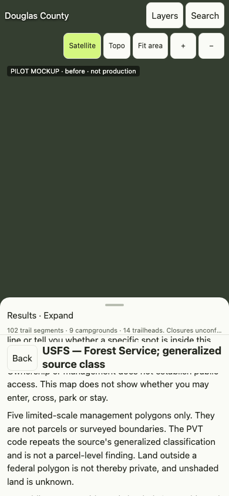
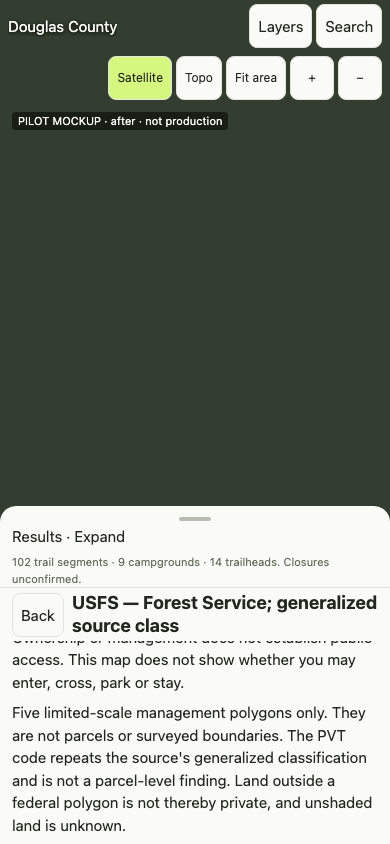
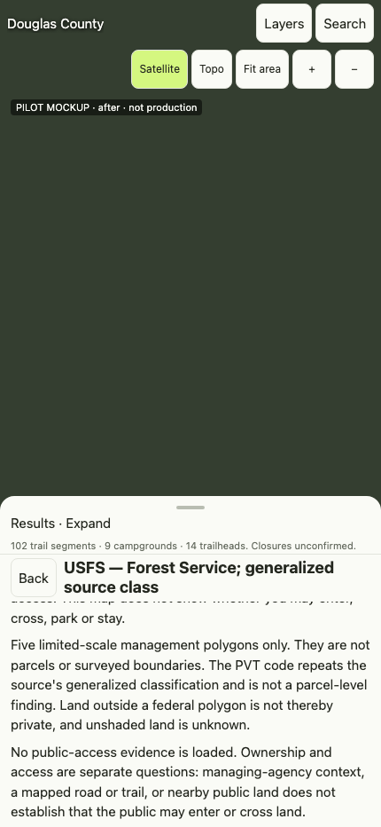

# Pilot: mobile sheet header and Back (NOT PRODUCTION, NOT APPROVED)

This is the one isolated pilot for the design-tooling proposal
([../../agent-stack/proposals/design-tooling-upgrade.md](../../agent-stack/proposals/design-tooling-upgrade.md)).
It shows the proposed workflow (shared spec → mockup → screenshots with the
existing CDP harness → accessibility and protected-wording checks) on a real
Explore problem: the mobile sheet header and Back behaviour addressed by
PR #39. Nothing here is served by the app, and no production file was edited.
No third-party skill or MCP server was installed or used to produce it.

## What is compared

| Variant | Structure | Source |
|---|---|---|
| `before` | Back + title are a sticky bar **inside** the scrolling body; the summary is one line with an ellipsis | main `c04f5d6` (`v2/explore/explore.css` loaded read-only) |
| `after` | Back + title in a normal-flow header **above** the single scrolling body; the summary wraps | PR #39 head `b83b2b0`; its CSS changes copied unmodified into [after.css](after.css) |
| `proposal` | `after` plus one full-width divider under the Back + title row | [proposal.css](proposal.css), pilot-only candidate refinement |

The sheet is in its half state with a land-feature detail open. The detail
content is a real Douglas County land feature (`v2/regions/douglas-co/display/land.geojson`,
first `USFS` feature) rendered by the production `ExploreLand.detail()` in
`v2/explore/land-style.js`, so every trust-bearing string (W3, W7, W11, the
W8 label, the manifest ownership and public-access statements) is the app's
own text. The summary uses the production Douglas template from
`v2/explore/browse.js` with mock counts; its trust-bearing tail
`Closures unconfirmed.` is unchanged.

## Run it

From the repository root, with Node 22+ and local Chrome (set `CHROME` if needed):

```sh
node docs/design/pilot/sheet-header-pilot.mjs                        # writes screenshots/ and pilot-report.json here
node docs/design/pilot/sheet-header-pilot.mjs --out /tmp/pilot-check # writes elsewhere, for comparison
```

The script imports `cdpClient`, `findChrome`, `waitFor`, `trackProcess`,
`freePort`, `closeSocket`, `stopChrome` and `closeServer` from
`v2/pipeline/tests/browser/run.mjs` and launches Chrome the same way
(`--headless=new`, temporary profile, every non-local request blocked by
`Fetch.failRequest`). It is **not** imported by `run.mjs` and is **not** in
CI. It needs no npm or pip dependency. It exits 1 if a protected-wording check
fails or the detail text differs between variants.

Viewports: 390×844 and 430×932, device scale 1 (small PNGs), mobile and touch
emulation, `prefers-reduced-motion: reduce`. Each variant is measured with the
body at `scrollTop` 0 and 160; the screenshot is taken at 160, the state in
which the iPhone report saw text behind and between the header rows.

Run-to-run: two consecutive runs on 2026-10-20 (Chrome 155.0.8059.80,
Node 24.21.0, macOS) produced a byte-identical `pilot-report.json`. PNG bytes
vary slightly between runs (headless rasterisation), so PNG hashes are not
recorded in the report.

## Results (from pilot-report.json)

| Check | before | after (PR #39) | proposal |
|---|---|---|---|
| Body scrollport starts at or below the last header row | **no** (body top 570 px, header rows end 631 px at 390×844) | yes | yes |
| Body paragraphs painted geometrically under a header row (all runs) | **8** | 0 | 0 |
| Each header row wins hit-testing at its centre | yes | yes | yes |
| Trust-bearing summary clipped by ellipsis | **yes at 390×844** (`Closures unconf…`) | no | no |
| Visible boundary between header and scrolling body | no | **no** | yes |
| Minimum text contrast in the sheet (WCAG 2.2 AA: 4.5:1, 3:1 large) | 5.21:1 pass | 5.21:1 pass | 5.21:1 pass |
| Controls below 44×44 CSS px | none | none | none |
| Sheet focus order follows visual order (toggle → Back → Sources & coverage) | yes | yes | yes |
| Focus indicator visible on every Tab stop | yes | yes | yes |
| Protected wording byte-identical (W3, W7, W11, W8 label, `Closures unconfirmed.`) | yes | yes | yes |
| Detail text identical across all variants and viewports | yes (one SHA-256) | | |

Screenshots (body scrolled to 160 px):

| | 390×844 | 430×932 |
|---|---|---|
| before |  |  |
| after |  |  |
| proposal |  |  |

## Findings

1. **The `before` defect is visible in headless Chrome, not only on iPhone.**
   At 390×844 a body line (`…line or tell you whether a specific spot is
   inside this`, from W7) is painted between the summary and the Back row,
   because the body's 12 px top padding sits above the sticky bar. This
   supports PR #39's root-cause analysis. Chrome is still not iPhone Safari:
   the owner's real-device check remains the gate for PR #39.
2. **`before` clips a trust-bearing statement.** The one-line summary
   ellipsis hides most of `Closures unconfirmed.` at 390×844. Trust principle 7
   and product principle 7 ("uncertainty must be visible") argue for wrapping,
   which PR #39 already does.
3. **PR #39 removes the overlap but leaves no visual boundary.** A body line
   partly scrolled out directly under the Back row reads as overlap in the
   screenshot even though it is correctly clipped. The `proposal` adds one
   full-width `--line` divider; no colour, label, wording, size or hit-target
   change. It is a candidate for Codex **after** PR #39 merges and the owner
   approves it; it is not part of PR #39.
4. **The summary at 11 px is the smallest text in the sheet** (contrast 5.21:1,
   passes AA). The draft design spec records 12 px as a target for new work and
   leaves the existing value to an owner decision.

## Limits

- A static mockup cannot exercise drag, snap, inertial scroll or the Safari
  toolbar; PR #39's own browser tests do. The pilot measures layout,
  hit-testing, contrast, target size, focus order and wording only.
- Contrast is computed from computed colours against the first opaque
  ancestor background; it does not account for images or transparency over
  the map.
- Focus order covers the visible sheet controls after the top bar and map
  controls; the detail body has no links for this feature.
